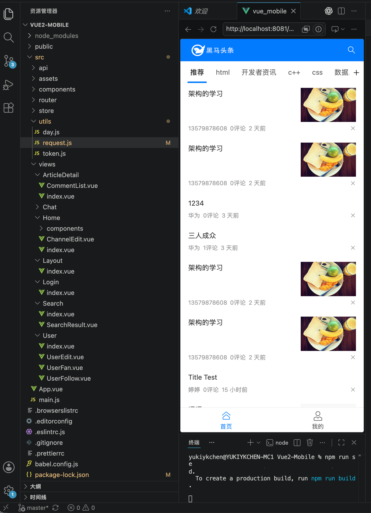
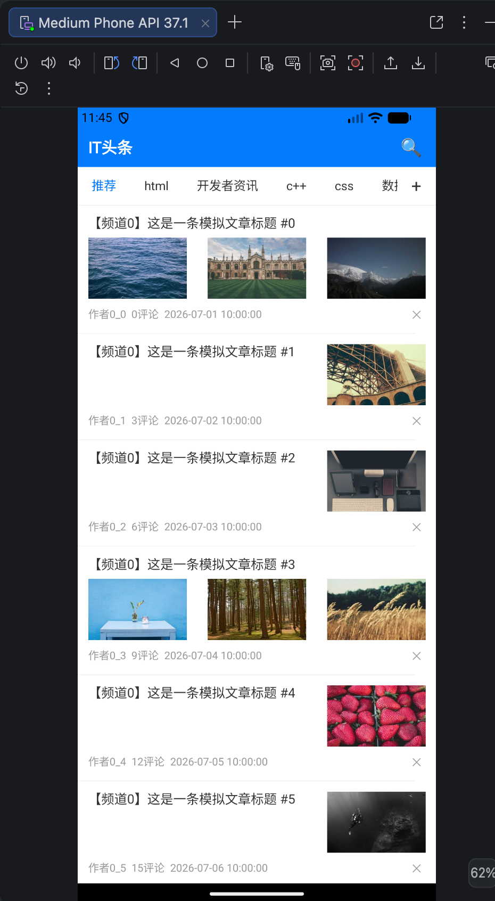

# Vue2Kuikly

把 Vue2 / Vue3 页面翻译成 Kuikly 代码的 Skill 仓库。主 Skill 负责通用翻译流程，业务 Skill 只补项目差异：先分析清楚，再按依赖逐文件生成，最后用编译和审计兜底。

迁移流水线：**零创造、零遗漏、按需规则、逐文件生成、编译闭环。**

## 仓库内容

| 目录 | 角色 |
| --- | --- |
| [`vue3tokuikly`](vue3tokuikly/SKILL.md) | Vue3 主 Skill。覆盖 Composition API、`script setup`、模板样式、组件库、路由、Pinia 和资源迁移。 |
| [`vue3tokuikly-config-skill`](vue3tokuikly-config-skill/SKILL.md) | Vue3 业务 Skill 模板。通过 `PATH_CONFIG` 注入项目关键字、业务规则、Checklist 和示例代码。 |
| [`vue2tokuikly`](vue2tokuikly/SKILL.md) | Vue2 迁移 Skill。按依赖层级把页面、组件、请求、存储和 Module 调用迁到 Kuikly。 |

## 转码流程

1. **读源项目。** 读取入口页面、组件依赖、状态、样式、资源、路由、请求和存储，列出 Vue 里实际有什么。
2. **分析语义和依赖。** 识别状态、props、`computed` / `watch`、事件、条件渲染、列表和资源引用，并按依赖分层排序。不按文件名猜测语义。
3. **加载转码知识。** 主 Skill 加载框架通用规则。传入业务 Skill 时，通过 `PATH_CONFIG` 加载项目自己的关键字、业务规则、Checklist 和示例代码。
4. **逐文件迁移。** 先转模型 / 工具，再转叶子组件，再转组合组件，最后转页面入口。关键逻辑保留 `// Source:` 注释，保证可追溯。
5. **资源同步。** 把图片、字体、SVG、`public` / `assets` 迁到目标 Kuikly assets，并生成资源映射。
6. **验证修复。** 跑 Kuikly 编译和资源校验。编译失败时按目标项目已有 API 修，不新增不存在的扩展函数。

## Vue3：主从分离

`vue3tokuikly` 是主 Skill，`vue3tokuikly-config-skill` 是业务 Skill。二者采用主从分离、接口约定、动态发现的插拔式架构：

- 主 Skill 只负责通用转换，不感知具体业务。
- 业务 Skill 用 `PATH_CONFIG` 声明资源路径，主 Skill 运行时扫描并加载，路径不写死。
- 项目差异放在业务 Skill 里，不写进框架层。

接入某个项目时，复制业务模板并改名，再在迁移时显式传入：

```bash
cp -R vue3tokuikly-config-skill myproject-vue3tokuikly

bash vue3tokuikly/scripts/build-knowledge-cache.sh \
  --pageName Vue3App \
  --workspaceDir .vue3tokuikly/Vue3App \
  --businessSkill ./myproject-vue3tokuikly
```

未传入 `--businessSkill` 时仍可做通用迁移，审计里需要记录“未应用业务规则”。完整步骤见 [`vue3tokuikly/SKILL.md`](vue3tokuikly/SKILL.md)。

## Vue2

`vue2tokuikly` 面向 Vue2 页面到 Kuikly 的一对一迁移。多个文件时先做依赖分层，再按从低到高的顺序生成。详细约束见 [`vue2tokuikly/SKILL.md`](vue2tokuikly/SKILL.md)。

## 测评记录

### Vue3

| 项 | 内容 |
| --- | --- |
| Skill | `vue3tokuikly` + `vue3tokuikly-config-skill` |
| 模型 | Codex + GPT 5.5 |

转码后的 Kuikly 页面：


### Vue2

| 项 | 内容 |
| --- | --- |
| 测试工程 | [P1kaj1uu/Vue2-Mobile](https://github.com/P1kaj1uu/Vue2-Mobile) |
| Skill | `vue2tokuikly` |
| Kuikly 壳工程 | 空白 Kuikly 模板工程 |
| 模型 | Claude Opus 4.7（1M context） |

Vue 页面：



转码后的 Kuikly 页面：


